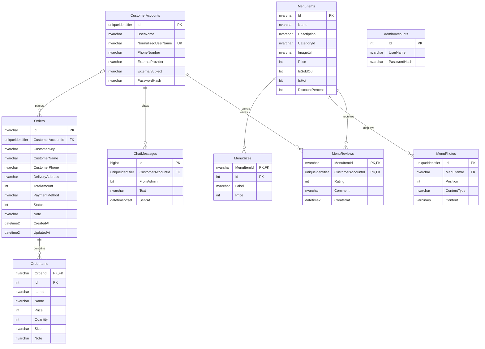

# Sơ đồ cơ sở dữ liệu CafeDuaHau

- Danh mục trên giao diện lấy từ `Data/MenuData.cs`. Món và giá theo kích cỡ lưu trong `MenuItems` và `MenuSizes`.
- `OrderItems` lưu tên, kích cỡ và giá tại thời điểm mua. `ItemId` là mã món lúc đặt, để lịch sử đơn vẫn hiển thị sau khi chủ quán xóa món.
- Đơn mới có khóa ngoại `CustomerAccountId`. Đơn đặt trước khi có đăng nhập giữ nguyên dữ liệu và mã trình duyệt cũ trong `CustomerKey`.
- `AdminAccounts` và `CustomerAccounts` lưu mật khẩu dưới dạng hash.
- Chạy `CafeDuaHau.sql` bằng SQL Server Management Studio hoặc `sqlcmd`. Ứng dụng cũng tự áp dụng migration khi chạy. Sau khi tạo database mới, dùng lệnh `dotnet run --no-launch-profile -- --setup-admin` trong thư mục dự án để thiết lập tài khoản chủ quán.

- Ảnh tải lên lưu trong MenuPhotos. Mỗi khách được đánh giá một lần cho mỗi món thuộc đơn đã giao.
- Trạng thái đơn lưu dưới dạng số trong SQL: 0 đã đặt, 1 đã hủy, 2 đã giao hàng.

- ChatMessages lưu tin nhắn giữa chủ quán và khách. Chỉ chủ quán và khách của cuộc trò chuyện được xem nội dung.

- Tài khoản khách mới có số điện thoại. Tài khoản Google hoặc Facebook được nhận diện bằng cặp ExternalProvider và ExternalSubject, có chỉ mục duy nhất.
